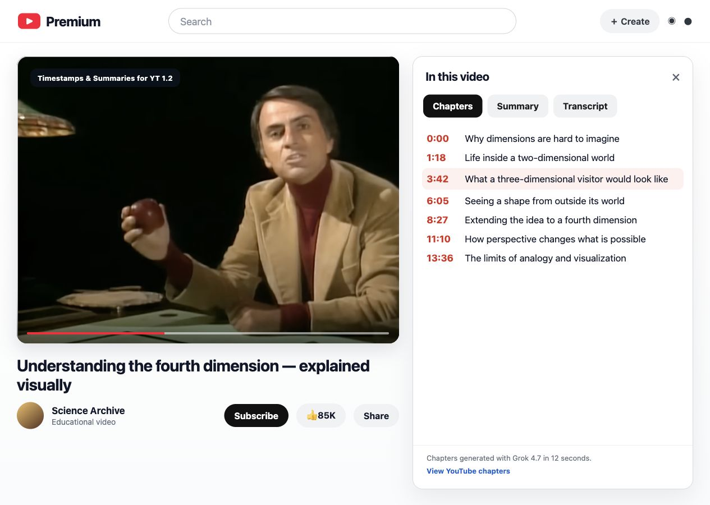

# Timestamps & Summaries for YT

A Safari extension for YouTube chapters and summaries.

Use YouTube’s chapters or generate them from the transcript. Click a chapter to jump to that point in the video. Read the summary beside YouTube’s Transcript tab.

[Download version 1.2](https://github.com/Hlbkomer/YouTube-Timestamps-and-Summaries/releases/latest/download/Timestamps-and-Summaries-for-YT.zip) · [Release notes](https://github.com/Hlbkomer/YouTube-Timestamps-and-Summaries/releases/tag/v1.2) · [Website](https://hlbkomer.github.io/YouTube-Timestamps-and-Summaries/)

## Setup

Requires Safari on macOS 26.4 or later.

1. Unzip the download and move the app to Applications.
2. Open the app and enable the extension in Safari Settings. Allow access to YouTube.
3. Choose your chapter and summary models in the app.

ChatGPT and Grok use subscription sign-in. Gemini uses your own Google AI Studio API key, with API usage billed to your Google project. Apple Intelligence can generate local summaries on a compatible Mac.

Generated chapters and summaries need captions or a transcript and may contain mistakes. YouTube’s existing chapters work without connecting a provider.

## Help and development

[Setup and support](https://hlbkomer.github.io/YouTube-Timestamps-and-Summaries/support.html) · [Report a problem](https://github.com/Hlbkomer/YouTube-Timestamps-and-Summaries/issues) · [Privacy](https://hlbkomer.github.io/YouTube-Timestamps-and-Summaries/privacy.html)

For contributors: [development guide](docs/development.md), [architecture](ARCHITECTURE.md), [changelog](CHANGELOG.md) and [release procedure](RELEASING.md).
