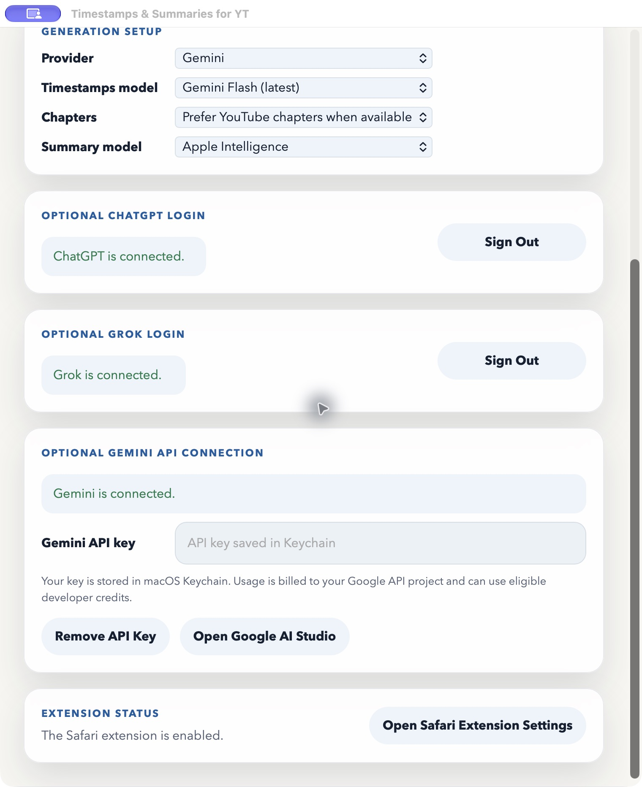
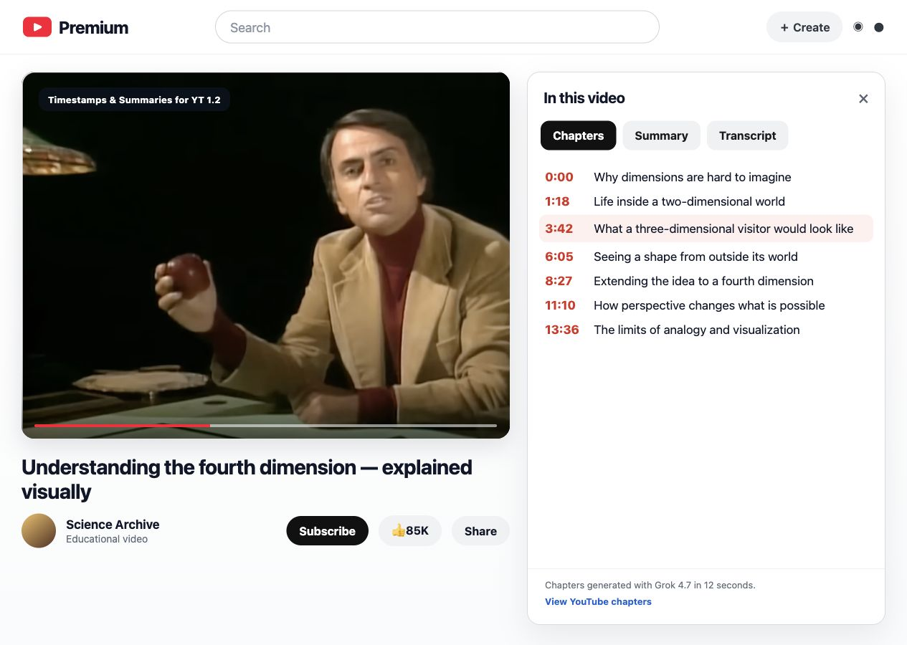
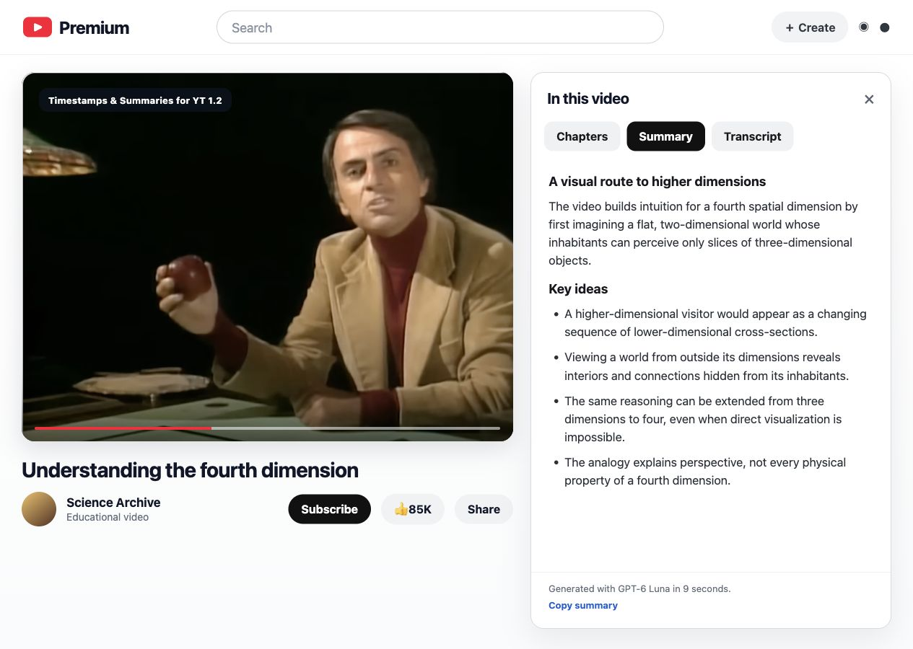

  <section class="yts-hero">
    

      
Safari extension for macOS

      <h1>Better YouTube Chapters</h1>
      
Add chapters and summaries to YouTube’s <em>In this video</em> panel. Click a chapter to jump to that part of the video, or read the summary alongside the transcript.

      

        <a class="yts-button yts-button-primary" href="https://github.com/Hlbkomer/YouTube-Timestamps-and-Summaries/releases/latest/download/Timestamps-and-Summaries-for-YT.zip">Download version 1.2</a>
        <a class="yts-button" href="https://github.com/Hlbkomer/YouTube-Timestamps-and-Summaries/releases/tag/v1.2">What’s new</a>
      

    

    

      
    

  </section>

  <section class="yts-section">
    <h2>Chapters and summaries</h2>
    
Use YouTube’s chapters or generate chapters from the transcript. The current chapter is highlighted as the video plays.

    

      <figure>
        
        <figcaption>Chapters. Interface preview with example content.</figcaption>
      </figure>
      <figure>
        
        <figcaption>Summary. Interface preview with example content.</figcaption>
      </figure>
    

  </section>

  <section class="yts-section">
    

      <article class="yts-card"><h3>Choose your models</h3>
Use Apple Intelligence for local summaries, or connect ChatGPT, Grok or Gemini. Chapters and summaries can use different models.
</article>
      <article class="yts-card"><h3>Connect your accounts</h3>
ChatGPT and Grok use your subscription sign-in. Gemini uses your Google AI Studio API key and is billed to your Google project.
</article>
      <article class="yts-card"><h3>Install in Safari</h3>
Requires macOS 26.4 or later. Move the app to Applications, open it, and enable the extension in Safari Settings. <a href="support.html">Setup and support</a>.
</article>
    

  </section>

